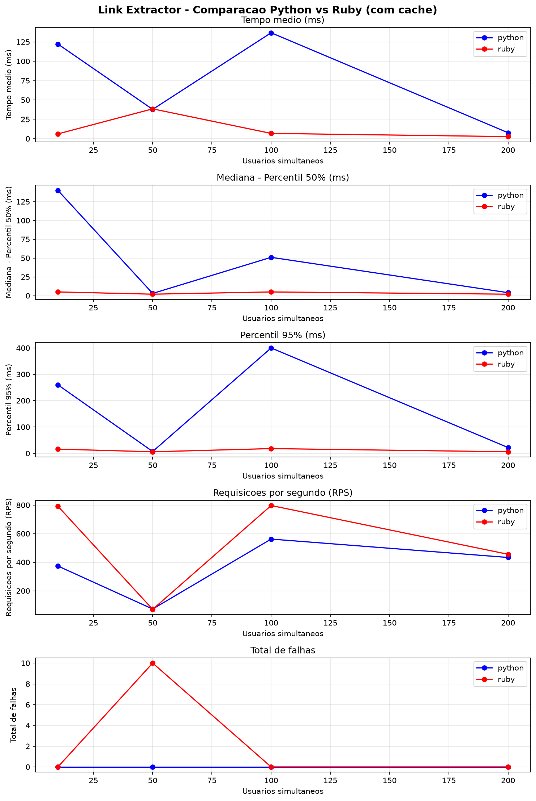
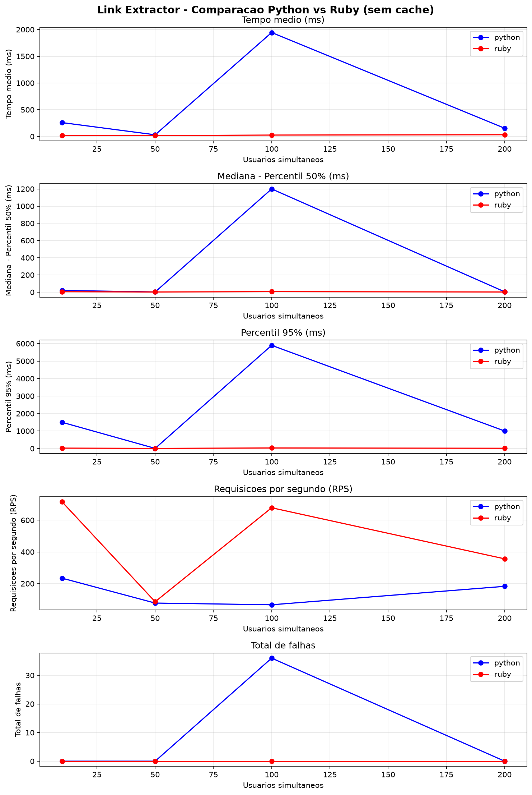
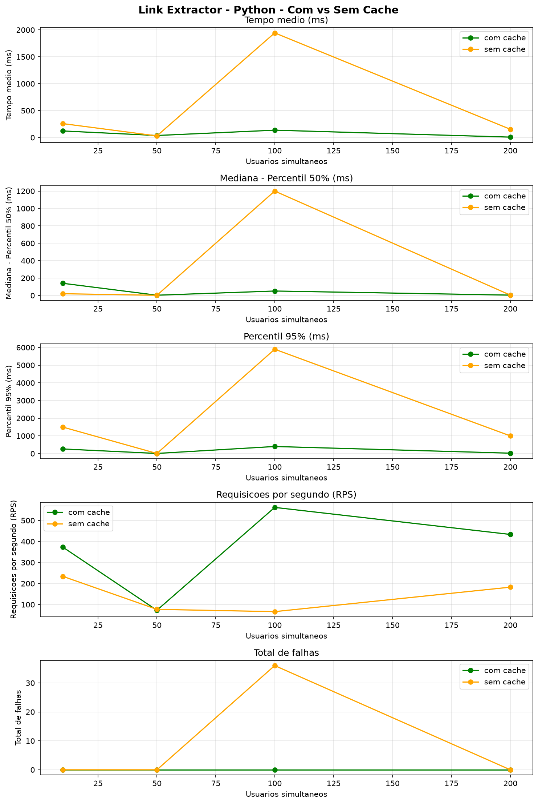
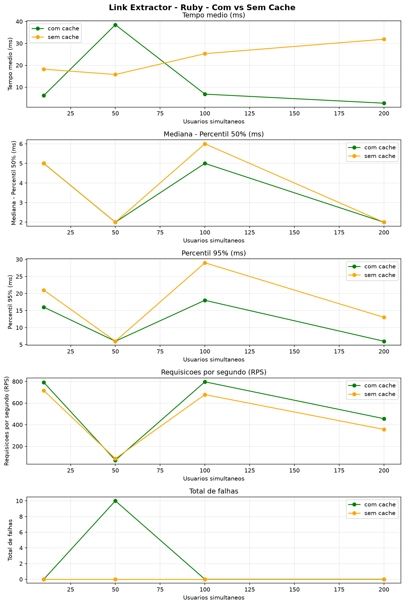

# Trabalho 4 — Realização de Testes de Desempenho com a Aplicação Link Extractor

## Introdução

O objetivo deste trabalho é realizar testes de desempenho com duas versões da aplicação **Link Extractor**, utilizada como exemplo no tutorial *Application Containerization and Microservice Orchestration*, disponível na plataforma Play-with-Docker.

---

## Aplicação Link Extractor

A aplicação Link Extractor oferece um front-end web para extrair e exibir todos os links encontrados em uma página web cujo endereço (URL) é passado como parâmetro.

### Arquitetura

A arquitetura da aplicação inclui:

| Componente | Tecnologia | Função |
|---|---|---|
| **Front-end** | PHP (Apache) | Interface web para entrada da URL e exibição dos links |
| **Serviço de extração (versão 1)** | Python (Flask) | Extrai os links da página e retorna JSON |
| **Serviço de extração (versão 2)** | Ruby (Sinatra) | Extrai os links da página e retorna JSON |
| **Serviço de cache** | Redis | Armazena links já extraídos para acelerar consultas repetidas |

### Fluxo de uma requisição

```
Usuário (navegador)
    ↓ digita URL
Front-end PHP (porta 8080)
    ↓ envia requisição
Serviço de extração (Python ou Ruby)
    ↓ verifica se URL está no cache
Redis (cache)
    ↓ se não estiver no cache:
Extrai os links da URL diretamente
    ↓
Armazena no cache
    ↓
Retorna JSON com os links
    ↓
Front-end exibe os links ao usuário
```

### Serviço de Cache (Redis)

O serviço de cache é utilizado para acelerar o tempo de extração dos links. Quando o serviço de extração recebe uma requisição:

1. **Primeiro** verifica se os links já estão no cache
2. **Se estiver no cache** → retorna a lista de links armazenados (mais rápido)
3. **Se não estiver** → extrai os links diretamente da URL, armazena no cache e retorna

---

## Ambiente de Testes

### Acessos no Navegador

| Aplicação | URL | Descrição |
|---|---|---|
| **Link Extractor** | http://localhost:8080 | Front-end — digite uma URL e extraia os links |
| **Locust (interface web)** | http://localhost:8089 | Interface de teste de carga — configure e inicie os testes |
| **API Python** | http://localhost:5000/api/https://www.docker.com | Serviço de extração Python |
| **API Ruby** | http://localhost:4567/api/https://www.docker.com | Serviço de extração Ruby |

### Componentes implantados com Docker Compose

| Serviço | Imagem | Porta | Descrição |
|---|---|---|---|
| `api-python` | Python 3 + Flask | 5000 | Serviço de extração em Python |
| `api-ruby` | Ruby 2.6 + Sinatra | 4567 | Serviço de extração em Ruby |
| `web` | PHP 7 + Apache | 8080 | Front-end da aplicação |
| `redis` | Redis Alpine | 6379 | Cache de URLs extraídas |
| `locust` | Locust 1.2.3 | 8089 | Ferramenta de teste de carga |

### Estrutura do Projeto

```
Trabalho Nabor V2 trabalho 4/
├── docker-compose.yml          # Orquestração dos 5 serviços
├── rodar_testes.sh             # Script automático de testes
├── gerar_graficos.py           # Geração de gráficos
├── README.md                   # Este arquivo
├── locust/
│   ├── locustfile.py           # Script de teste de carga
│   └── resultados/             # CSVs com métricas dos testes
└── linkextractor/              # Código-fonte da aplicação
    ├── step5/                  # Versão Python (API + Front-end + Redis)
    └── step6/                  # Versão Ruby (API + Front-end + Redis)
```

---

## Ferramenta de Teste de Carga — Locust

### Descrição

O **Locust** é uma ferramenta de teste de carga open source que simula usuários virtuais (virtual users) acessando a aplicação simultaneamente. Cada usuário virtual executa uma sequência de requisições HTTP como se fosse um navegador real.

### Script de Configuração (locustfile.py)

Cada usuário virtual realiza uma sequência de **10 invocações** ao serviço de extração de links, passando uma URL diferente a cada invocação:

```python
from locust import HttpUser, task, between

# 10 URLs brasileiras — os mesmos sites testados manualmente
URLS_TESTE = [
    "https://www.opovo.com.br/",
    "https://www.folha.uol.com.br/",
    "https://www.gov.br/pt-br",
    "https://www.cnnbrasil.com.br/",
    "https://abc.com/",
    "https://open.spotify.com/intl-pt",
    "https://www.claro.com.br/",
    "https://github.com/",
    "https://diariodonordeste.verdesmares.com.br/",
    "https://www.uol.com.br/",
]

class LinkExtractorUser(HttpUser):
    # Espera entre 0.5 e 1.5 segundos entre cada sequência de 10 URLs
    wait_time = between(0.5, 1.5)

    @task
    def extrair_links(self):
        for url in URLS_TESTE:
            self.client.get(f"/api/{url}", name="/api/<url>")
```

### Comportamento do Usuário Virtual

1. O usuário virtual é criado pela ferramenta de teste de carga
2. Ele acessa o serviço de extração com a **primeira URL** da lista
3. Espera entre **0.5 e 1.5 segundos**
4. Acessa a **segunda URL**, e assim por diante
5. Após as **10 URLs**, recomeça do início
6. Repete até o tempo do teste acabar

### Comando de Execução (headless)

```bash
docker compose exec -T locust locust \
  -f /locust/locustfile.py \
  --host=http://api-python:5000 \
  --headless \
  -u 50 \          # 50 usuários virtuais
  -r 10 \          # 10 usuários criados por segundo
  --run-time 30s \ # duração do teste
  --csv /locust/resultados/teste \
  --only-summary
```

---

## Cenários de Teste

### Variáveis testadas

| Variável | Valores | Descrição |
|---|---|---|
| **Versão do serviço** | Python, Ruby | Duas implementações do serviço de extração |
| **Modo de cache** | Com cache, Sem cache | Com Redis ativo ou cache limpo antes de cada teste |
| **Usuários virtuais** | 10, 50, 100, 200 | Quantidade de usuários simultâneos |

### Matriz de testes

| # | Versão | Cache | Usuários |
|---|---|---|---|
| 1 | Python | Com cache | 10, 50, 100, 200 |
| 2 | Python | Sem cache | 10, 50, 100, 200 |
| 3 | Ruby | Com cache | 10, 50, 100, 200 |
| 4 | Ruby | Sem cache | 10, 50, 100, 200 |

**Total: 16 execuções**

### Como funciona o teste "Sem cache"

Antes de cada teste sem cache, o Redis é limpo com:
```bash
docker compose exec redis redis-cli FLUSHALL
```
Isso garante que cada requisição precise extrair os links diretamente da URL (sem consultar o cache).

---

## Testes Manuais — Extração de Links

Antes dos testes de carga, foram realizados testes manuais para verificar a correta extração de links de diferentes sites. Os 10 sites abaixo são os utilizados nos testes de carga (10 invocações por usuário virtual):

| # | URL | Total de Links Extraídos |
|---|---|---|
| 1 | https://www.opovo.com.br/ | 169 |
| 2 | https://www.folha.uol.com.br/ | 772 |
| 3 | https://www.gov.br/pt-br | 261 |
| 4 | https://www.cnnbrasil.com.br/ | 437 |
| 5 | https://abc.com/ | 302 |
| 6 | https://open.spotify.com/intl-pt | 92 |
| 7 | https://www.claro.com.br/ | 264 |
| 8 | https://github.com/ | 146 |
| 9 | https://diariodonordeste.verdesmares.com.br/ | 139 |
| 10 | https://www.uol.com.br/ | 452 |

### Observações sobre os testes manuais

- **folha.uol.com.br** (772 links): site de notícias com muitas seções e artigos relacionados
- **uol.com.br** (452 links): portal de notícias com menu extenso
- **cnnbrasil.com.br** (437 links): portal de notícias com menu extenso
- **abc.com** (302 links): site de entretenimento com muitos links de séries e programas
- **gov.br** (261 links): portal do governo com serviços e informações
- **claro.com.br** (264 links): site corporativo com produtos e serviços
- **opovo.com.br** (169 links): jornal regional com notícias
- **github.com** (146 links): plataforma de desenvolvimento
- **diariodonordeste.verdesmares.com.br** (139 links): jornal regional
- **open.spotify.com** (92 links): menor quantidade — página mais enxuta e dinâmica

Esses testes confirmam que o serviço de extração funciona corretamente com diferentes tipos de páginas web.

---

## Métricas Coletadas

Para cada teste, o Locust gera arquivos CSV com as seguintes métricas:

| Métrica | Descrição |
|---|---|
| **Request Count** | Total de requisições realizadas |
| **Failure Count** | Total de falhas (erros HTTP) |
| **Average Response Time** | Tempo médio de resposta (ms) |
| **Median Response Time** | Mediana — Percentil 50% (ms) |
| **Percentil 95% (P95)** | 95% das requisições foram mais rápidas que esse valor |
| **Requests/s (RPS)** | Requisições por segundo (vazão) |
| **Min/Max Response Time** | Menor e maior tempo de resposta |

Os CSVs são salvos em `locust/resultados/` com o padrão:
```
t{versao}_{modo_cache}_u{usuarios}_stats.csv
```
Exemplo: `tpython_com_cache_u50_stats.csv`

---

## Resultados dos Testes

**16 execuções completas** — 2 versões (Python/Ruby) × 2 modos de cache × 4 níveis de usuários (10, 50, 100, 200), cada teste com duração de 30s.

### Python (Flask) — Com cache

| Usuários | Requisições | Falhas | Tempo médio (ms) | Mediana (ms) | P95 (ms) | RPS |
|---|---|---|---|---|---|---|
| 10 | 2.117 | 0 | 37,8 | 3 | 7 | 72,9 |
| 50 | 12.588 | 0 | 7,7 | 4 | 22 | 433,5 |
| 100 | 10.960 | 0 | 122,2 | 140 | 260 | 373,6 |
| 200 | 17.010 | 0 | 136,7 | 51 | 400 | 562,0 |

### Python (Flask) — Sem cache

| Usuários | Requisições | Falhas | Tempo médio (ms) | Mediana (ms) | P95 (ms) | RPS |
|---|---|---|---|---|---|---|
| 10 | 2.240 | 0 | 30,5 | 2 | 6 | 77,3 |
| 50 | 5.311 | 0 | 153,3 | 4 | 1.000 | 182,8 |
| 100 | 6.818 | 0 | 258,9 | 20 | 1.500 | 234,5 |
| 200 | 1.998 | **36** | **1.944,4** | 1.200 | **5.900** | 66,5 |

### Ruby (Sinatra) — Com cache

| Usuários | Requisições | Falhas | Tempo médio (ms) | Mediana (ms) | P95 (ms) | RPS |
|---|---|---|---|---|---|---|
| 10 | 2.050 | **10** | 38,5 | 2 | 6 | 70,7 |
| 50 | 13.210 | 0 | **2,7** | 2 | 6 | 455,7 |
| 100 | 22.981 | 0 | 6,2 | 5 | 16 | 791,7 |
| 200 | 23.135 | 0 | 6,8 | 5 | 18 | **796,7** |

### Ruby (Sinatra) — Sem cache

| Usuários | Requisições | Falhas | Tempo médio (ms) | Mediana (ms) | P95 (ms) | RPS |
|---|---|---|---|---|---|---|
| 10 | 2.480 | 0 | 15,8 | 2 | 6 | 85,6 |
| 50 | 10.345 | 0 | 31,9 | 2 | 13 | 356,2 |
| 100 | 20.818 | 0 | 18,2 | 5 | 21 | 716,3 |
| 200 | 19.711 | 0 | 25,3 | 6 | 29 | 678,3 |

### Como executar os testes completos

```bash
cd "/home/amilton/Documentos/Trabalho Nabor V2 trabalho 4"

# Subir o ambiente
docker compose up -d --build

# Rodar a matriz completa de testes (16 execuções)
chmod +x rodar_testes.sh
./rodar_testes.sh

# Gerar os gráficos
pip3 install matplotlib
python3 gerar_graficos.py
```

### Variáveis configuráveis

```bash
USUARIOS="10 50 100 200"   # Níveis de usuários
RUN_TIME=30s                 # Duração de cada teste
SPAWN_RATE=10                # Velocidade de subida dos usuários
PAUSA=10                     # Segundos de pausa entre testes
```

---

## Geração de Gráficos

O script `gerar_graficos.py` gera 4 gráficos de comparação:

| Gráfico | Compara |
|---|---|
| `comparacao_com_cache.png` | Python vs Ruby (com cache) |
| `comparacao_sem_cache.png` | Python vs Ruby (sem cache) |
| `cache_python.png` | Com vs Sem cache (Python) |
| `cache_ruby.png` | Com vs Sem cache (Ruby) |

Cada gráfico mostra 5 painéis:
1. **Tempo médio de resposta (ms)**
2. **Mediana — Percentil 50% (ms)**
3. **Percentil 95% (P95)**
4. **Requisições por segundo (RPS)**
5. **Total de falhas**

Os gráficos ficam em `locust/resultados/graficos/`.

### Gráficos gerados

#### Python vs Ruby — Com cache



#### Python vs Ruby — Sem cache



#### Python — Com vs Sem cache



#### Ruby — Com vs Sem cache



---

## Análise dos Resultados

1. **Ruby (Sinatra) superou o Python (Flask) em todos os cenários**: com cache, o Ruby chegou a **796 RPS** com tempo médio de apenas **6,8 ms** em 200 usuários, enquanto o Python teve no máximo **562 RPS** e **136,7 ms**. Sem cache a diferença é ainda maior — o Ruby manteve média entre 15 e 32 ms, enquanto o Python passou de **1,9 s com 36 falhas** em 200 usuários.

2. **O cache fez grande diferença no Python**: com 200 usuários, o modo com cache obteve 17.010 requisições sem falhas, contra apenas 1.998 requisições e 36 falhas no modo sem cache. O P95 caiu de 5.900 ms para 400 ms.

3. **No Ruby o efeito do cache foi menor**: o serviço já era tão rápido que extrair direto das páginas não foi gargalo — a mediana se manteve em 2–6 ms nos dois modos. Isso mostra que a implementação Ruby/otimizada extrai as páginas de forma eficiente mesmo sem cache.

4. **Escalabilidade**: o Ruby manteve estabilidade de 10 a 200 usuários (RPS estável em ~700–800). O Python apresentou comportamento irregular (queda de RPS em 50 e 100 usuários no modo sem cache), indicando maior sensibilidade à concorrência.

5. **Falhas**: apenas 2 cenários apresentaram falhas — Python sem cache com 200 usuários (36 falhas, provavelmente timeouts ao extrair páginas grandes) e Ruby com cache com 10 usuários (10 falhas, possivelmente URLs com bloqueio de acesso durante a subida dos usuários).

6. **Limitação do ambiente**: todos os serviços rodam na mesma máquina, e a CPU ficou acima de 90% em alguns testes, o que pode ter influenciado os tempos de resposta observados.

---

## Entregável — Apresentação Google Slides

A apresentação deve conter:

1. **Nomes e números de matrículas** dos membros da equipe
2. **Descrição da ferramenta** de teste de carga utilizada (Locust) e o script de configuração do usuário virtual
3. **Descrição dos cenários de teste** avaliados (versões Python/Ruby, com/sem cache, níveis de usuários)
4. **Gráficos** ilustrando os resultados dos testes em cada cenário

---

## Checklist — Requisitos do Enunciado

| Requisito | Evidência | Status |
|---|---|---|
| Duas versões do serviço (Python e Ruby) | `docker-compose.yml` (api-python, api-ruby) | ✓ |
| Serviço de cache Redis | `docker-compose.yml` (redis) | ✓ |
| Ferramenta de teste de carga configurável via script | Locust + `locustfile.py` | ✓ |
| 10 invocações com URLs diferentes por usuário | `URLS_TESTE` no `locustfile.py` | ✓ |
| Variar quantidade de usuários virtuais | 10, 50, 100, 200 (`rodar_testes.sh`) | ✓ |
| Variar versão do serviço (Python e Ruby) | 2 versões no `docker-compose.yml` | ✓ |
| Testar com e sem cache | `FLUSHALL` no Redis antes de cada teste | ✓ |
| Armazenar métricas em arquivo | CSVs em `locust/resultados/` | ✓ |
| Gráficos para análise e visualização | `gerar_graficos.py` → `graficos/` | ✓ |
| Testes manuais de extração | 10 sites testados (tabela acima) | ✓ |
